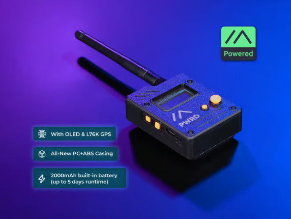
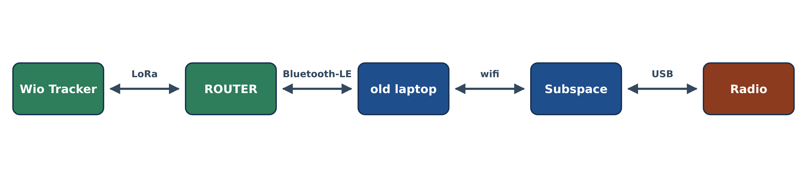

This project will enable basic communication "away from the shack" using the JS8 protocol with [Subspace](https://github.com/avantol/Subspace-Edition/releases/latest) over a Meshtastic network.

The problem that's solved here is: "USB cables aren't long enough to run from within Bluetooth LE range of my Meshtastic router to the PC that runs my radio". 

That's where the wi-fi link to the PC with the Subspace API comes in, it replaces the usual USB cable a "Companion" requires.

The controlling device is any Meshtastic "Companion", like the [Seeed Studio Wio Tracker L1 Pro](https://media-cdn.seeedstudio.com/cdn-cgi/image/format=auto%2Cwidth=640%2Cquality=75/media/catalog/product/cache/961a49e1875f8c1f40e5990d74e68365/2/0/20260408-135305.jpg).

You can enter a message (like "CQ") and receive the responses drirected to you. From there, you can carry on a standard JS8 QSO.

You can also get notifications directed to any group(s) you want.

Here is the architecture:

The "old laptop" is actually a gateway, running the code in this repo. The test laptop was an ancient low-spec ASUS T100T with 2GB memory, running a recent Linux Mint. Anything that has a "Bluetooth Low Energy" (a.k.a "Bluetooth 4.0") module will do.

If you require a more fully-featured QSO "away from the shack", check out the Subspace project [here](https://github.com/avantol/Subspace-Edition/releases/latest), and try the "Phone remote" feature. 
Screenshots for that are at [js8ss.com](https://js8ss.com)

The command summary is here: [COMMANDs.md](https://github.com/avantol/Subspace-Meshtastic-Basic/blob/main/COMMANDS.md)
